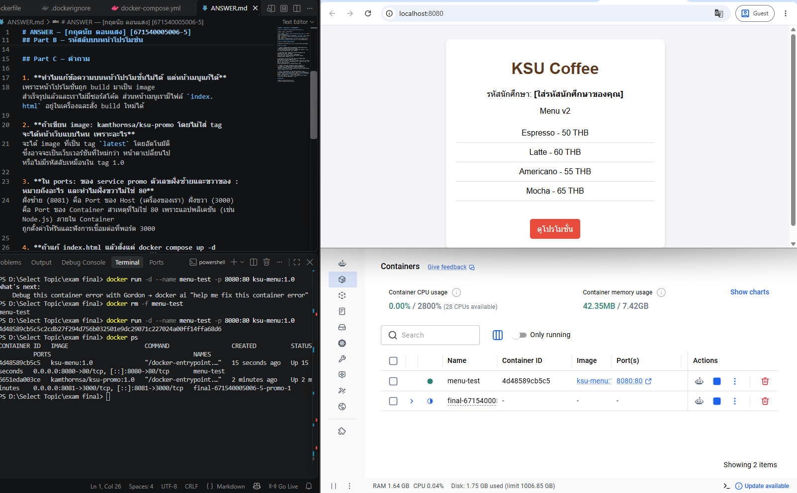
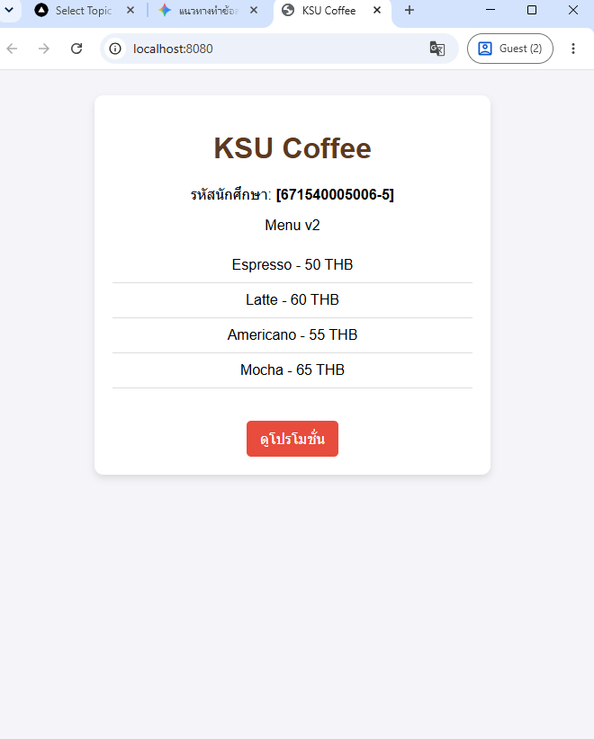
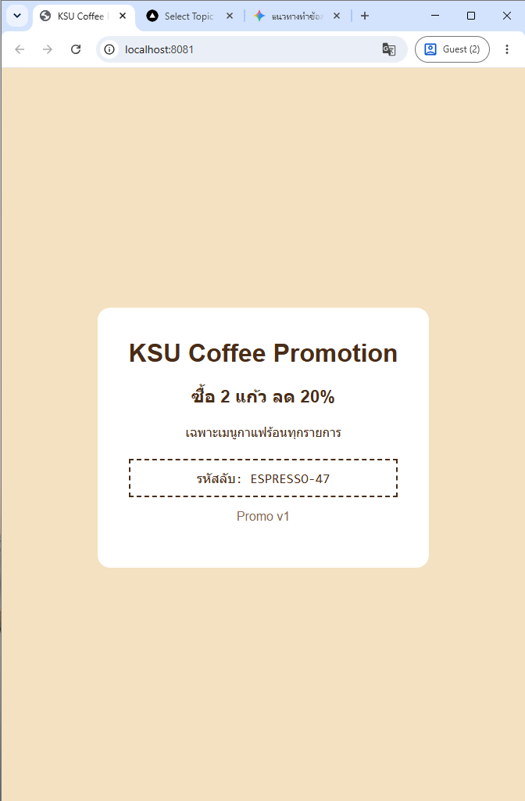

# ANSWER — [กฤตนัย ดอนแสง] [671540005006-5]

## Part A — ข้อมูลจาก image kamthornsa/ksu-promo:1.0

| คำถาม | คำตอบ | คำสั่งที่ใช้ |
| --- | --- | --- |
| Port | 3000 | `docker inspect kamthornsa/ksu-promo:1.0` (ดูตรง Config.ExposedPorts) |
| CMD | [เติมคำตอบที่ได้จากการรันคำสั่ง เช่น "npm", "start" หรือ "node", "app.js"] | `docker inspect kamthornsa/ksu-promo:1.0` (ดูตรง Config.Cmd) |
| Base image | [เติมคำตอบที่ได้ เช่น node:alpine หรือ alpine] | `docker history kamthornsa/ksu-promo:1.0` (ดูเลเยอร์ล่างสุด) |

## Part B — รหัสลับบนหน้าโปรโมชั่น

[รหัสลับ: ESPRESSO-47]

## Part C — คำถาม

1. **ทำไมแก้ข้อความบนหน้าโปรโมชั่นไม่ได้ แต่หน้าเมนูแก้ได้**
เพราะหน้าโปรโมชั่นถูก build มาเป็น image สำเร็จรูปแล้วและเราไม่มีซอร์สโค้ด ส่วนหน้าเมนูเรามีไฟล์ `index.html` อยู่ในเครื่องและสั่ง build ใหม่ได้

2. **ถ้าเขียน image: kamthornsa/ksu-promo โดยไม่ใส่ tag จะได้หน้าเว็บแบบไหน เพราะอะไร**
จะได้ image ที่เป็น tag `latest` โดยอัตโนมัติ ซึ่งอาจจะเป็นเว็บเวอร์ชันที่ใหม่กว่า หน้าตาเปลี่ยนไป หรือไม่มีรหัสลับเหมือนใน tag 1.0

3. **ใน ports: ของ service promo ตัวเลขฝั่งซ้ายและขวาของ : หมายถึงอะไร และทำไมฝั่งขวาไม่ใช่ 80**
ฝั่งซ้าย (8081) คือ Port ของ Host (เครื่องของเรา) ฝั่งขวา (3000) คือ Port ของ Container สาเหตุที่ไม่ใช่ 80 เพราะแอปพลิเคชัน (เช่น Node.js) ภายใน Container ถูกตั้งค่าให้รันและฟังการเชื่อมต่อที่พอร์ต 3000

4. **ถ้าแก้ index.html แล้วสั่งแค่ docker compose up -d จะเกิดอะไรขึ้น เพราะอะไร และคำสั่งที่ถูกต้องคืออะไร**
จะไม่มีการเปลี่ยนแปลงบนหน้าเว็บ เพราะ Docker จะใช้ image เดิมที่เคย build ไว้แล้ว คำสั่งที่ถูกต้องเพื่อให้ build ใหม่คือ `docker compose up -d --build`

5. **ลิงก์ "ดูโปรโมชั่น" ใช้ URL อะไร และทำไมใช้ http://promo:3000 ไม่ได้ ทั้งที่ใน Compose เรียก service ด้วยชื่อได้**
ใช้ URL `http://localhost:8081` สาเหตุที่ใช้ `http://promo:3000` ไม่ได้ เพราะการคลิกลิงก์เกิดขึ้นที่ฝั่ง Client (เว็บเบราว์เซอร์ของ user บน Host) ซึ่งอยู่นอก Docker Network จึงไม่รู้จักชื่อ DNS ภายในอย่าง `promo`

## ภาพหน้าจอ

